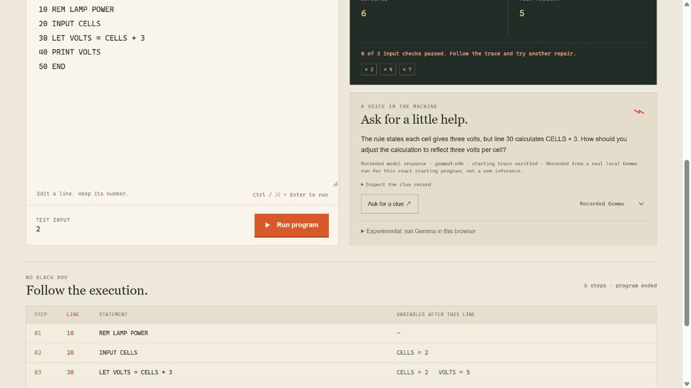

# The Last Save

Repair five broken BASIC programs to recover a fictional computer's memories. Edit real code, run it, compare its output, and follow the executed lines and variable values. Every repair must pass three different input cases.

## Play the web demo

[Play The Last Save](https://the-last-save-queuecarelab.alightape20.chatgpt.site)

The web demo uses clearly labelled recorded Gemma clues. Live local inference is available with the Python server below; the optional browser model is experimental. The five puzzles work without downloading a model.



## Play locally

Requires Python 3. No package installation is needed for the game or recorded clues.

```sh
python tools/serve_local.py
```

Open `http://127.0.0.1:8076` on the same computer. This is a local address, not a hosted demo. Alternatively, for the static game without the optional Ollama API:

```sh
python -m http.server 8076 --bind 127.0.0.1 --directory dist
```

Choose a disk, run its damaged code, and change a line while preserving its line number. Run with the button or Ctrl/Cmd+Enter. The execution trace shows why a result differs. Each successful repair unlocks a memory; progress and edits are stored in that browser. How to play explains the BASIC syntax. Reveal this repair supplies an authored solution.

## Puzzles and interpreter

- First light: arithmetic and a lamp's voltage.
- The missing beat: a loop boundary.
- The second hand: a countdown that runs in the wrong direction.
- The warm room: the zero-temperature boundary.
- The last save: updating state in a Fibonacci sequence.

The small interpreter supports REM, LET, INPUT, PRINT, IF/THEN, GOTO, END, numeric expressions and comparisons. It does not use JavaScript eval or execute shell commands. Limits bound source length, parser depth, executed steps and output. This is an educational subset, not a complete historical BASIC implementation.

## Clue sources

The default clues are five reviewed responses from actual local `gemma4:e4b` calls. They are labelled as recorded, and are used only when the original program and its execution trace match the saved record. The interpreter, not a model, grades repairs. Edited programs do not silently receive stale recorded clues.

The local server optionally calls an existing Ollama service at `127.0.0.1:11434`. Live browser inference is experimental and was not runtime-verified for this release. It uses WebLLM 0.2.86 and `gemma3-1b-it-q4f16_1-MLC`, requires WebGPU, and downloads about 600–700 MB only after the explicit load button. The core puzzles and recorded clues do not require that download or an API key.

To try fresh local clues, install Ollama from its official website, run `ollama pull gemma4:e4b`, and leave Ollama running. Start `python tools/serve_local.py`, open the local address printed by that command on the same computer, run a puzzle, and select **Live local Ollama** in the clue menu. A different locally installed model can be selected with `python tools/serve_local.py --model MODEL_NAME`. Model downloads and inference require sufficient memory and disk space; no model weights are included here.

See `reports/hint-evaluation.json` for actual requests, outputs and rejected attempts. These are curated development examples, not an independent benchmark. Initial-program prompts include the author's focus line; edited live programs do not assume that original fault location. No model weights are redistributed.

## Verification

```sh
node --test tests/engine.test.mjs
```

14 engine tests passed, including all five broken programs and all 15 repair/input combinations. Actual browser interaction also completed every puzzle and verified progress survives reload; see `reports/browser-gameplay.json`. Browser model execution remains unverified.

## Sources and licensing

Game source and fictional story: MIT, QueueCareLab. Developed with AI coding assistance.

- [WebLLM](https://github.com/mlc-ai/web-llm)
- [Gemma models](https://ai.google.dev/gemma)
- [Ollama](https://github.com/ollama/ollama)

External model and runtime downloads remain subject to their own licences and terms.
